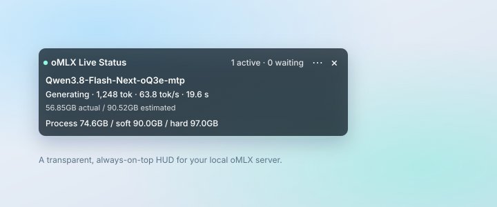

# oMLX Status HUD

**English** · [简体中文](README.zh-CN.md)

> A transparent, always-on-top floating card that shows what your local [oMLX](https://omlx.app) server is doing right now — tokens per second, the request queue, and how close you are to the memory ceiling.

[](#requirements)
[](#requirements)
[](#requirements)
[](https://github.com/lixiang0106/omlx-monitor/releases/latest)
[](LICENSE)



## At a glance

| | |
| --- | --- |
| What it is | A native macOS floating status card for a local oMLX server |
| Also called | oMLX 状态浮窗, oMLX monitor, oMLX HUD |
| Runs on | macOS 13 Ventura or later; Apple Silicon recommended, tested on M5 Max |
| Written in | Swift 5 with AppKit — no third-party dependencies, no package manager |
| Install | Download from [Releases](https://github.com/lixiang0106/omlx-monitor/releases/latest), or `./build.sh` |
| Shows | tokens/s, generated tokens, prefill progress, active and waiting requests, process memory against soft and hard limits |
| Data source | `GET http://127.0.0.1:<port>/admin/api/activity`, read-only, every 2 seconds |
| Requires | oMLX running locally with its admin API enabled |
| Licence | MIT |

---

## Why

oMLX already has a dashboard, but it lives in a browser tab. When you are running a 70B-class model on one machine, the questions that matter are continuous and trivial: *Is it generating or still prefilling? How fast? Is something queued behind me? Am I about to hit the hard memory limit?*

Switching tabs to answer them costs more than the answer is worth. This HUD keeps a small, semi-transparent card pinned above your windows, updating twice a second, so the answer is always one glance away.

## Features

- **Live generation metrics** — output tokens, `tok/s`, elapsed time, and prefill progress (`processed / total`) for the request in flight.
- **Queue visibility** — active and waiting counts per model, so a stall is obvious instead of mysterious.
- **Memory headroom** — process footprint next to oMLX's soft and hard limits, exactly as the memory guard sees them.
- **Genuinely out of the way** — transparent by default, borderless, always on top, joins every Space and full-screen app, draggable from any pixel, and remembers where you left it.
- **Adaptable sizing** — 4 widths (340/448/560/680 pt), 4 text sizes (10–16 pt), and a compact row mode; the card height follows the content.
- **Bilingual UI** — follows your system language automatically, or force 中文 / English from the menu.
- **Honest when offline** — if the server stops responding, the card says so instead of quietly showing stale numbers.
- **Zero configuration** — no YAML, no config file, no helper daemons. One Swift source file plus one build script.

## Requirements

| Item | Requirement |
| --- | --- |
| macOS | 13 Ventura or later (Apple Silicon recommended) |
| oMLX | A running local server with the admin API enabled |
| Toolchain | Xcode Command Line Tools (`xcode-select --install`) |

The HUD talks to `http://127.0.0.1:<port>/admin/api/activity`, reading the port and API key from your own `~/.omlx/settings.json`.

## Install

### Download (fastest)

1. Download `oMLX-Status-HUD-1.1.0.zip` from [Releases](https://github.com/lixiang0106/omlx-monitor/releases/latest) and unzip it.
2. Move `oMLX Status HUD.app` into `/Applications`.
3. First launch: right-click the app → **Open**.

**Gatekeeper note.** The app is ad-hoc signed rather than notarized, so macOS may say it cannot verify the developer. Either right-click → **Open** → **Open**, or clear the quarantine flag:

```bash
xattr -dr com.apple.quarantine "/Applications/oMLX Status HUD.app"
```

### Build from source

```bash
git clone https://github.com/lixiang0106/omlx-monitor.git
cd omlx-monitor
./build.sh
open "dist/oMLX Status HUD.app"
```

The build takes a few seconds and runs an offline self-test before finishing. The result is a self-contained `.app` — no runtime dependencies, no separate icon assets to manage.

Optional: add the app to **System Settings → General → Login Items** so it starts with your Mac. The HUD does not install a launch agent on its own.

## Usage

| Action | How |
| --- | --- |
| Move the card | Drag anywhere on the card |
| Resize / change text size | Click **⋯** → **Width** or **Text size** |
| Hide model memory rows | **⋯** → **Compact rows** |
| Switch language | **⋯** → **Language** |
| Turn the backdrop on or off | **⋯** → **Turn backdrop on** |
| Snap back to the top-left corner | **⋯** → **Move to top-left** |
| Quit | **×** on the card, or the menu-bar **oMLX** item |

Because the card is transparent, light desktops can reduce contrast. Turning on the backdrop adds a dark, translucent panel behind the text; switching to dark text is also available for bright wallpapers.

## FAQ

**How do I watch oMLX tokens per second without switching browser tabs?**
Run this HUD. It reads `/admin/api/activity` every 2 seconds and shows the current request's generated token count, tokens per second, and elapsed time directly on the desktop.

**How can I tell whether the server is still prefilling a long prompt or already generating?**
A prefilling request shows `Prefilling` with `processed / total` prompt tokens and a prefill speed. Once decoding starts, the same row switches to `Generating` with output tokens and tokens per second. The two phases look different on purpose.

**How many requests are queued behind the current one?**
Each model row carries an active and waiting count, and the header carries the totals. With the scheduler concurrency of 1 observed on our machine, a waiting count above zero means your request is behind someone else's.

**How close is oMLX to its soft and hard memory limits?**
The bottom row shows the oMLX process footprint next to the limits its memory guard is enforcing — for example `74.6GB / soft 90.0GB / hard 97.0GB`. These are the same values that drive eviction, not a separate estimate.

**Does it change my models, sampling settings, or memory limits?**
No. The app only issues `GET` requests. It never writes to the oMLX configuration and never loads or unloads a model.

**Where does the API key come from, and is it stored?**
It is read from `~/.omlx/settings.json` at request time, used for a single request to `127.0.0.1`, and never written to disk, logged, or shown on screen. Redirects are refused so it cannot be forwarded elsewhere.

**Can I change the size, font, or language?**
Yes. The **⋯** menu offers four widths (340–680 pt), four text sizes (10–16 pt), a compact row mode, and a language switch between 中文 and English. The height follows the content, and the position is remembered.

**What is the difference from the oMLX web dashboard?**
The dashboard lives in a browser tab and answers the same questions after a context switch. This HUD keeps a small card pinned above other windows, including across Spaces and full-screen apps, so the numbers stay in peripheral vision. It is a complement, not a replacement.

## How it works

Every 2 seconds the app issues a single read-only request:

```
GET http://127.0.0.1:<port>/admin/api/activity
Authorization: Bearer <api key from ~/.omlx/settings.json>
```

It renders the response fields `active_requests`, `waiting_requests`, `generating`, `prefilling`, and `memory_pressure`, and never sends inference requests of its own.

## Privacy and security

- **Loopback only.** The app has no reason to reach any other host and does not do so. HTTP redirects are refused so a credential can never be forwarded elsewhere.
- **The API key is never stored.** It is read from your existing oMLX settings on each request, held in memory, and neither written to disk, logged, nor displayed.
- **No telemetry, no analytics, no update checks.**
- **Read-only.** The HUD never changes oMLX settings, models, or memory limits.

Two inherent caveats: the file is read with your user's permissions, and any local process that can bind the configured port could observe the request. Both are consequences of talking to a local server over loopback HTTP. See [SECURITY.md](SECURITY.md) if you want the details.

## Troubleshooting

| Message on the card | Meaning and fix |
| --- | --- |
| `Cannot read the oMLX settings file` | oMLX has never run for this user, or it is installed under a different path. Launch oMLX once. |
| `oMLX not reachable — retrying` | The server is not listening. Start oMLX, or check `server.port` in its settings. |
| `Authentication failed` | The API key changed after the HUD started. Quit and relaunch. |
| `oMLX request failed (HTTP …)` | The admin API is disabled or the endpoint moved in a newer oMLX release. |
| Card shows `No model loaded` | The server is healthy but idle; nothing is resident in memory yet. |
| No icon in Finder | Re-run `./build.sh`; the icon is generated from `Sources/DrawIcon.swift`. |

## Development

```
Sources/OMLXMonitor.swift   AppKit window, polling, layout, localization
Sources/DrawIcon.swift      Draws the 10 required icon sizes with AppKit
Info.plist                  Bundle metadata
build.sh                    Compiles, renders the icon, signs, self-tests
```

The executable exposes three diagnostic modes that do not touch the UI state of a running instance:

```bash
dist/"oMLX Status HUD.app"/Contents/MacOS/OMLXMonitor --self-test        # parsing, layout, i18n
dist/"oMLX Status HUD.app"/Contents/MacOS/OMLXMonitor --probe            # one live request
dist/"oMLX Status HUD.app"/Contents/MacOS/OMLXMonitor --gui-diagnostic   # window geometry
```

There is deliberately no package manager, no third-party dependency, and no build system beyond `swiftc`.

A machine-readable project summary lives in [`llms.txt`](llms.txt); build and verification instructions aimed at coding agents live in [`AGENTS.md`](AGENTS.md).

## Limitations

- Shows up to four loaded models; extras are summarised as a count.
- Verified against oMLX 0.7.x on macOS 27 with an M5 Max. Older releases may expose a different activity payload; the card reports an unusable payload rather than guessing.
- Chinese and English only. Adding a language means adding one `L.t(...)` table entry per string.
- Single-instance; the app intentionally has no Dock icon (`LSUIElement`).

## Contributing

Issues and pull requests are welcome. For anything that changes the polling model, the credential handling, or the layout algorithm, please open an issue first — those three areas are small on purpose, and keeping them small is the main design constraint.

## License

[MIT](LICENSE). Not affiliated with the oMLX project; oMLX is a separate product and this tool only reads its local status endpoint.
