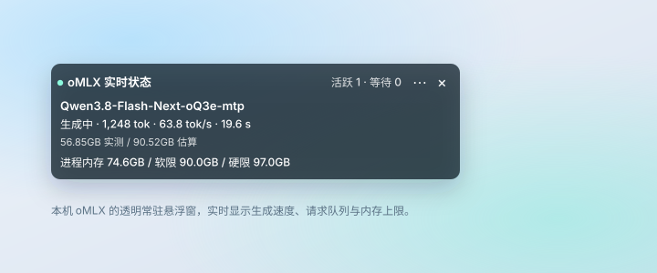

# oMLX 状态浮窗

[English](README.md) · **简体中文**

> 一个透明、常驻置顶的小浮窗，实时显示本机 [oMLX](https://omlx.app) 正在做什么：生成速度、请求排队情况，以及距离内存上限还有多少余量。

[](#环境要求)
[](#环境要求)
[](#环境要求)
[](LICENSE)



---

## 为什么做这个

oMLX 自带有面板，但它在浏览器标签页里。在这台机器上跑 70B 级模型时，真正需要随时知道的几件事都很朴素：现在是在生成还是仍在预填充？速度多少？后面有没有请求在排队？内存离硬限还有多远？

为了看这些数字切换标签页，成本高于答案本身。这个浮窗把一块半透明的小卡片钉在窗口上方，两秒刷新一次，抬眼就能看到。

## 功能

- **实时生成指标**：当前请求的输出 token 数、`tok/s`、已用时间，以及预填充进度（`processed / total`）。
- **排队可见**：每个模型的活跃与等待请求数，卡顿会直接显示出来，不必再靠猜。
- **内存余量**：进程实际占用与 oMLX 软限、硬限并排显示，取值口径与内存保护器一致。
- **确实不碍事**：默认透明、无边框、置顶，跟随所有桌面空间和全屏应用；任意位置可拖动，并记住上次位置。
- **尺寸可调**：4 档宽度（340 / 448 / 560 / 680 pt）、4 档字号（10–16 pt）、可隐藏明细行的紧凑模式；窗口高度随内容变化。
- **中英双语界面**：默认跟随系统语言，也可在菜单里固定为中文或 English。
- **离线如实提示**：服务不再响应时直接显示不可用，不会把旧数字当作实时值继续展示。
- **零配置**：不需要改 YAML、不需要额外配置文件、不驻留后台守护进程；一个 Swift 源文件加一个构建脚本。

## 环境要求

| 项目 | 要求 |
| --- | --- |
| 系统 | macOS 13 Ventura 及以上（建议 Apple Silicon） |
| oMLX | 本地服务已启动，管理接口可用 |
| 工具链 | Xcode Command Line Tools（`xcode-select --install`） |

浮窗访问 `http://127.0.0.1:<端口>/admin/api/activity`，端口与 API key 都从你自己的 `~/.omlx/settings.json` 读取。

## 安装

```bash
git clone https://github.com/lixiang0106/omlx-monitor.git
cd omlx-monitor
./build.sh
open "dist/oMLX Status HUD.app"
```

构建耗时数秒，结束前会跑一遍离线自检。产物是完整的 `.app`，没有运行时依赖，也不需要单独管理图标资源。

**关于 Gatekeeper。** 应用使用 ad-hoc 签名，没有经过公证。首次启动时 macOS 可能提示无法验证开发者，右键点击应用 → **打开** → **打开** 即可；也可以清除隔离标记：

```bash
xattr -dr com.apple.quarantine "dist/oMLX Status HUD.app"
```

需要开机自启时，把应用放进 `/Applications`，再到 **系统设置 → 通用 → 登录项** 里添加。浮窗本身不会写入任何自启配置。

## 使用方法

| 操作 | 方式 |
| --- | --- |
| 移动浮窗 | 在卡片任意位置拖动 |
| 调整宽度或字号 | 点 **⋯** → **浮窗宽度** / **字体大小** |
| 隐藏模型内存明细 | **⋯** → **精简显示** |
| 切换语言 | **⋯** → **语言** |
| 开关半透明底色 | **⋯** → **启用半透明底色** |
| 回到左上角 | **⋯** → **移回屏幕左上角** |
| 退出 | 卡片上的 **×**，或菜单栏 **oMLX** 图标里的退出项 |

卡片透明时，浅色桌面上文字对比度偏低。打开半透明底色会在文字后加一层深色面板，也可以改为深色文字，适配亮色壁纸。

## 数据来源

每 2 秒发出一次只读请求：

```
GET http://127.0.0.1:<端口>/admin/api/activity
Authorization: Bearer <从 ~/.omlx/settings.json 读取的 API key>
```

读取 `active_requests`、`waiting_requests`、`generating`、`prefilling`、`memory_pressure` 等字段，自身不发送任何推理请求。

## 隐私与安全

- **只连本机环回地址。** 应用不需要访问其他主机，也不会访问；HTTP 重定向被拒绝，凭据不会被转发到别处。
- **API key 不落地。** 每次请求时从现有 oMLX 设置中读取，仅在内存中使用，不写入磁盘、不打印日志、不显示在界面上。
- **无遥测、无统计、无更新检查。**
- **只读。** 不修改 oMLX 的模型、参数或内存上限。

两个固有前提需要说明：设置文件以你的用户权限读取；本机任何能占用所配置端口的进程都可能观察到这次请求。这两点是"通过环回 HTTP 访问本地服务"本身带来的，不是额外设计选择。细节见 [SECURITY.md](SECURITY.md)。

## 常见问题

| 卡片提示 | 含义与处理 |
| --- | --- |
| `无法读取 oMLX 设置` | 当前用户从未运行过 oMLX，或其安装路径不同。启动一次 oMLX 即可。 |
| `oMLX 未连接，正在重试` | 服务未监听。启动 oMLX，或核对其设置中的 `server.port`。 |
| `身份验证失败` | 浮窗启动后 API key 发生了变化。退出后重新打开。 |
| `oMLX 接口不可用（HTTP …）` | 管理接口被关闭，或新版本 oMLX 更换了路径。 |
| 显示 `暂无已加载的模型` | 服务正常但处于空闲状态，当前没有模型驻留内存。 |
| Finder 里没有图标 | 重新运行 `./build.sh`；图标由 `Sources/DrawIcon.swift` 生成。 |

## 开发说明

```
Sources/OMLXMonitor.swift   窗口、轮询、排版与本地化
Sources/DrawIcon.swift      用 AppKit 绘制 10 个尺寸的图标
Info.plist                  Bundle 元数据
build.sh                    编译、生成图标、签名、自检
```

可执行文件提供三种诊断模式，不会干扰正在运行的实例：

```bash
dist/"oMLX Status HUD.app"/Contents/MacOS/OMLXMonitor --self-test        # 解析、排版、双语
dist/"oMLX Status HUD.app"/Contents/MacOS/OMLXMonitor --probe            # 单次真实请求
dist/"oMLX Status HUD.app"/Contents/MacOS/OMLXMonitor --gui-diagnostic   # 窗口几何
```

刻意不引入包管理器、第三方依赖或额外构建系统，`swiftc` 之外没有别的步骤。

## 已知限制

- 最多展开 4 个已加载模型，其余以数量汇总。
- 在 macOS 27 + M5 Max 上针对 oMLX 0.7.x 验证。旧版本的活动接口字段若有差异，卡片会显示数据不可用，不会猜测取值。
- 仅提供中文与英文。新增语言即逐条补一张 `L.t(...)` 文案表。
- 单实例运行；应用刻意不显示 Dock 图标（`LSUIElement`）。

## 参与贡献

欢迎提交 issue 和 pull request。涉及轮询模型、凭据处理、排版算法这三处的改动，建议先开 issue 讨论：这三块代码刻意保持很小，维持这个规模本身就是设计约束。

## 许可

[MIT](LICENSE)。本项目与 oMLX 官方无隶属关系；oMLX 是独立产品，本工具只读取其本地状态接口。
